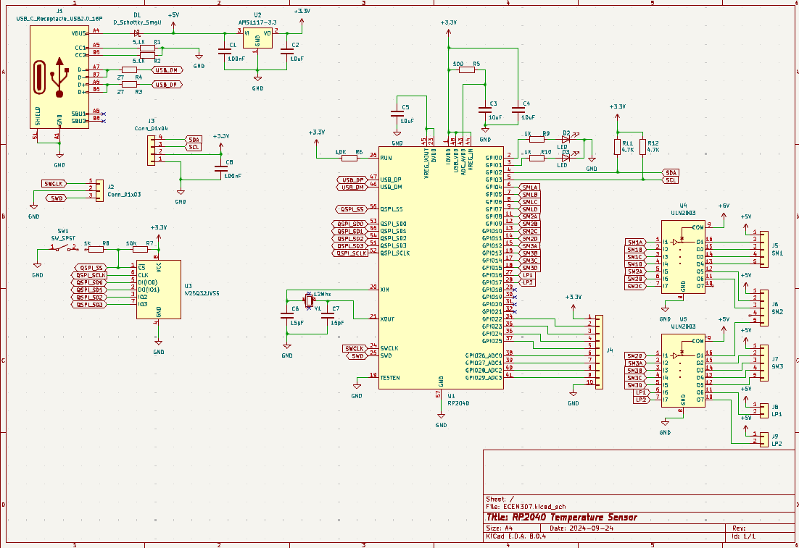
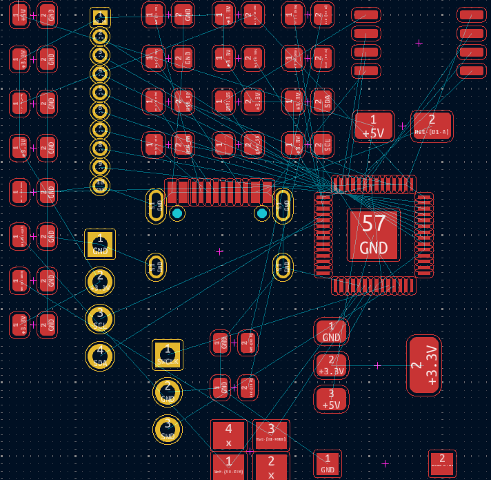
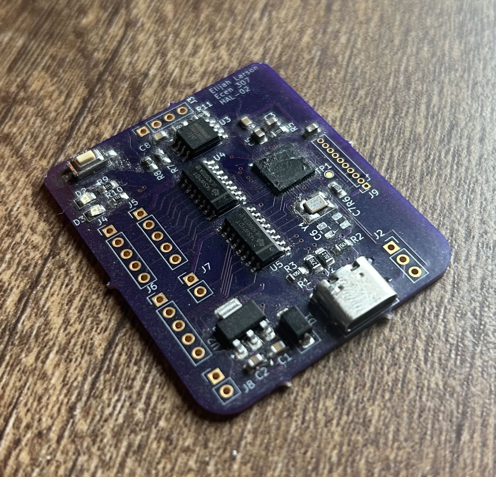

# Custom RP2040 Embedded Controller PCB

A custom two-layer embedded controller designed in KiCad around the **bare RP2040 microcontroller**.

I built this project to move beyond development boards and learn what it takes to design a microcontroller system from the component level. Instead of using a Raspberry Pi Pico module, I implemented the supporting circuitry for the RP2040 myself, including power, clocking, external flash, USB, programming support, and peripheral interfaces.

I took the board from schematic capture through PCB layout, fabrication, hand assembly, firmware programming, and hardware bring-up. The finished board successfully booted and ran firmware, and I validated its I2C interfaces and external load-driver circuitry.

---

## Hardware

The board includes an RP2040 microcontroller, external QSPI flash, crystal and clock circuitry, 3.3 V power regulation and decoupling, USB-C, I2C interfaces, external load-driver circuitry, and programming/boot support.

Component selection and circuit implementation were based on manufacturer datasheets, reference designs, and the electrical requirements of the system.

---

## Schematic Design

Designing around the bare RP2040 meant implementing circuitry that would normally already exist on a development board.

That included providing the RP2040 with its external flash, clock source, regulated power, decoupling, USB connection, and the circuitry needed to program and boot the device. I also added the I2C and load-driver interfaces needed for the rest of the system.

*KiCad schematic for the custom RP2040 controller.*

Working through the schematic gave me much more experience reading datasheets and reference designs than I would have gotten from simply connecting peripherals to a development board. It also forced me to think about how each part of the circuit supported the microcontroller as a complete system.

---

## PCB Design

Once the schematic was complete, I moved into component placement and routing for the two-layer PCB.

*Initial component placement before any traces were routed.*

This image shows the board at the beginning of the layout process. The components had been brought into the PCB editor, but the actual placement and routing work had not yet been completed.

From there, I organized the components around their electrical relationships and worked through the routing of the complete board. This was one of my first experiences seeing how decisions that look simple on a schematic become physical layout problems once board space, routing, connectors, and component access all have to be considered together.

---

## Fabrication and Assembly

After completing the layout, I had the PCB fabricated and assembled the board by hand.

*Fabricated and hand-assembled RP2040 controller.*

Getting the physical board back was where the project became much more interesting. At that point, the question was no longer whether the schematic looked correct — I had to determine whether the actual hardware behaved the way I expected.

---

## Board Bring-Up

I approached bring-up incrementally rather than immediately trying to run the entire system.

I started with visual inspection and basic power checks, then verified the regulated supply before moving on to the RP2040 itself. Once I confirmed that the microcontroller could be programmed and boot successfully, I loaded firmware and began testing the external interfaces.

The board successfully reached the point where I could:

- Program and boot the RP2040
- Run firmware on the assembled hardware
- Communicate over the I2C interfaces
- Control the external load-driver circuitry

The biggest lesson from bring-up was the importance of **working outward from the fundamentals**. If something was not behaving correctly, I learned to verify power, ground, connections, and the physical interface before assuming the problem was in firmware.

That debugging process has carried into the hardware projects I've worked on since.

---

## What I Would Change in Rev B

The board worked, but building and bringing it up showed me several things I would approach differently on a second revision.

The biggest improvement would be **designing for test and debug from the beginning**. I would add dedicated test points for important power rails and interfaces, make programming and debug access more intentional, and improve the silkscreen so components and connectors are easier to identify while working on the assembled board.

I would also reorganize the schematic into clearer functional blocks. On this revision, my main focus was getting the electrical design working. With more PCB experience now, I place much more value on making a schematic easy for another engineer to understand and review.

Finally, I would define the bring-up and functional test procedure before sending the board out for fabrication rather than developing that process while testing the finished hardware.

One of the biggest things this project taught me is that a good PCB is not just electrically correct. It should also be **understandable, testable, debuggable, and maintainable**.

---

## Why This Project Matters to Me

This was one of my first complete custom microcontroller PCB designs, and it changed how I thought about embedded hardware.

Using development boards makes it easy to treat the microcontroller as a black box. Designing around the bare RP2040 forced me to understand what actually has to exist around the processor for it to power up, boot, store firmware, communicate, and interact with external hardware.

More importantly, I got to follow the design all the way from a schematic on my computer to a physical board that I could program, measure, debug, and improve.

That **schematic → PCB → assembly → bring-up → debugging** process is the part of hardware engineering I enjoy most.
